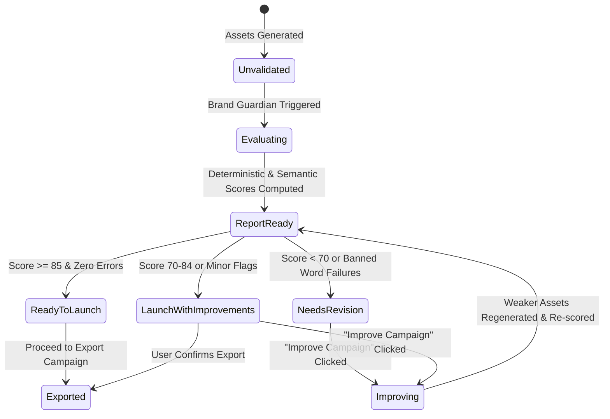

# Data Model: Campaign Report Card

**Feature**: `002-campaign-report-card`  
**Date**: 2026-11-19  
**Status**: Ready  

---

## 1. Entity Definitions & Schemas

### `CampaignReportCard`
The core aggregate entity representing the executive health of a campaign.

| Field | Type | Required | Description |
|---|---|---|---|
| `id` | String (UUID) | Yes | Unique identifier for this report card |
| `campaign_id` | String | Yes | ID of the associated campaign |
| `overall_score` | Integer | Yes | Composite health score (0–100) |
| `grade` | String | Yes | Calculated letter grade (`A+`, `A`, `B`, `C`, `D`) |
| `launch_readiness` | String | Yes | Status enum: `Ready to Launch`, `Launch with Improvements`, `Needs Revision` |
| `score_breakdown` | `ScoreBreakdown` | Yes | 5-category evaluation object |
| `persona_impacts` | List[`PersonaImpact`] | Yes | Breakdown for each persona targeted |
| `predicted_performance` | `PredictedPerformance` | Yes | Channel engagement forecasts |
| `ai_insights` | `AIInsights` | Yes | Strengths, opportunities, and recommendations |
| `generated_at` | String (ISO 8601) | Yes | Timestamp of report generation |

---

### `ScoreBreakdown`
Sub-entity containing the 5 category metrics visualized on the radar chart and metric cards.

| Field | Type | Bounds | Description |
|---|---|---|---|
| `brand_consistency` | Integer | 0–100 | Alignment with core brand tone, values, and guidelines |
| `persona_relevance` | Integer | 0–100 | Depth of psychological resonance for target personas |
| `marketing_quality` | Integer | 0–100 | Readability, flow, clarity, and persuasive structure |
| `creativity` | Integer | 0–100 | Originality, hook distinctiveness, and vocabulary richness |
| `compliance` | Integer | 0–100 | Strict adherence to length constraints and zero banned words |

---

### `PersonaImpact`
Evaluates individual persona effectiveness across the campaign.

| Field | Type | Description |
|---|---|---|
| `persona_id` | String | Unique persona identifier |
| `persona_name` | String | Display name (e.g., "Enterprise CISO", "Student") |
| `relevance_score` | Integer | Segment fit rating (0–100) |
| `primary_trigger` | String | Core psychological driver (e.g., "Risk mitigation & boardroom compliance") |

---

### `PredictedPerformance`
Channel-specific forecast metrics compared against standard industry benchmarks.

| Field | Type | Example | Description |
|---|---|---|---|
| `linkedin_engagement_rate` | String | `"4.8%"` | Projected social engagement rate |
| `linkedin_benchmark` | String | `"3.8%"` | Industry average comparison |
| `email_open_rate` | String | `"28.4%"` | Projected email open percentage |
| `email_benchmark` | String | `"21.5%"` | Industry average comparison |
| `click_through_rate` | String | `"3.6%"` | Projected CTR percentage |
| `ctr_benchmark` | String | `"2.4%"` | Industry average comparison |

---

### `AIInsights`
Structured strategic diagnostics.

| Field | Type | Description |
|---|---|---|
| `top_strengths` | List[String] | 2–4 verified strengths of the current copy |
| `improvement_opportunities` | List[String] | 1–3 areas with room for refinement |
| `recommendations` | List[String] | 2–3 actionable next steps for distribution |

---

### `ImprovementOption`
Actionable repair item returned by the "Improve Campaign" analysis.

| Field | Type | Description |
|---|---|---|
| `asset_id` | String | ID of the underperforming asset |
| `persona_name` | String | Target persona |
| `channel` | String | Channel type (`social_post` or `email`) |
| `current_issue` | String | Diagnostic finding (e.g., "Length exceeds 280 chars", "Weak value hook") |
| `suggested_action` | String | Recommended remediation prompt |
| `regenerated_content` | Object (Optional) | Newly generated copy if user approves repair |

---

## 2. Deterministic State Transitions



---

## 3. Storage & JSON Schema

Report card records are persisted inside each campaign record in `backend/data/campaigns.json` under the key `report_card`.

```json
{
  "id": "camp-travelmate-001",
  "name": "TravelMate Smart Mug",
  "brand_kit": { ... },
  "personas": [ ... ],
  "assets": [ ... ],
  "brand_guardian_results": { ... },
  "report_card": {
    "id": "rc-travelmate-001",
    "overall_score": 96,
    "grade": "A+",
    "launch_readiness": "Ready to Launch",
    "score_breakdown": {
      "brand_consistency": 96,
      "persona_relevance": 98,
      "marketing_quality": 95,
      "creativity": 94,
      "compliance": 97
    },
    "persona_impacts": [
      {
        "persona_id": "p-student",
        "persona_name": "Student",
        "relevance_score": 96,
        "primary_trigger": "Affordable convenience between study sessions"
      },
      {
        "persona_id": "p-pro",
        "persona_name": "Working Professional",
        "relevance_score": 98,
        "primary_trigger": "Desk ergonomics and uninterrupted focus"
      }
    ],
    "predicted_performance": {
      "linkedin_engagement_rate": "5.2%",
      "linkedin_benchmark": "3.8%",
      "email_open_rate": "31.2%",
      "email_benchmark": "21.5%",
      "click_through_rate": "3.9%",
      "ctr_benchmark": "2.4%"
    },
    "ai_insights": {
      "top_strengths": [
        "Strong audience differentiation between Student and Executive personas",
        "100% compliance with Brand Kit length and banned-word rules"
      ],
      "improvement_opportunities": [
        "Email subject line could incorporate more urgent call-to-action"
      ],
      "recommendations": [
        "A/B test the morning commute hook for the professional segment"
      ]
    },
    "generated_at": "2026-11-19T12:00:00Z"
  }
}
```
