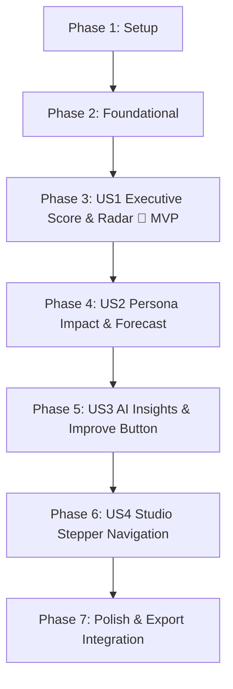

# Tasks: Campaign Report Card

**Input**: Design documents from `specs/002-campaign-report-card/` (`spec.md`, `plan.md`, `research.md`, `data-model.md`, `contracts/`, `quickstart.md`)  
**Prerequisites**: `plan.md` (completed), `spec.md` (completed), `data-model.md` (completed), `contracts/` (completed)  
**Tests**: Tests are MANDATORY per Principle II (Test-Driven Development). Tests must be written and failing before implementing functional requirements.  
**Organization**: Tasks are grouped by user story to enable independent implementation and testing of each story.

---

## Format: `[ID] [P?] [Story] Description`
- **[P]**: Can run in parallel (different files, no dependencies)
- **[Story]**: Which user story this task belongs to (e.g. `[US1]`, `[US2]`, `[US3]`, `[US4]`)
- Every task includes explicit file paths

---

## Phase 1: Setup (Shared Infrastructure)

**Purpose**: Scaffolding and model foundations for the Report Card feature.

- [X] T001 Create report card backend and frontend file scaffolding in `backend/app/services/` and `frontend/src/components/`
- [X] T002 [P] Define Pydantic schema and entities for `CampaignReportCard` in `backend/app/models/report_card.py` per data-model.md

---

## Phase 2: Foundational (Blocking Prerequisites)

**Purpose**: Core calculation engines and routing prerequisites required by all user stories.

- [X] T003 Implement Brand Guardian metric aggregation and 5-dimension score synthesis in `backend/app/services/report_card_service.py`
- [X] T004 [P] Implement deterministic letter grade (`A+` to `D`) and Launch Readiness status evaluation in `backend/app/services/report_card_service.py`
- [X] T005 [P] Implement channel benchmark performance prediction heuristics in `backend/app/services/performance_forecast_service.py`
- [X] T006 Setup report card API blueprint and register routes in `backend/app/routes/report_card_routes.py` and `backend/app/__init__.py`

**Checkpoint**: Core calculation services and API blueprint ready for story-level implementation.

---

## Phase 3: User Story 1 - Executive Campaign Quality & Launch Readiness (Priority: P1) 🎯 MVP

**Goal**: Display overall campaign score (0–100), letter grade badge, launch readiness status, and 5-axis radar chart.  
**Independent Test**: Load a campaign into the Report Card view and verify that score, grade, readiness, and SVG radar chart accurately render aggregated health.

### Tests for User Story 1 (MANDATORY - TDD) ⚠️
- [X] T007 [P] [US1] Write unit and contract tests in `backend/tests/test_report_card.py` for score synthesis, grade mapping, and `GET /api/campaigns/<id>/report-card`
- [X] T008 [P] [US1] Write frontend component tests in `frontend/tests/CampaignRadarChart.test.jsx` verifying 5-axis SVG polygon rendering and score badge styling

### Implementation for User Story 1
- [X] T009 [US1] Implement `GET /api/campaigns/<id>/report-card` endpoint in `backend/app/routes/report_card_routes.py`
- [X] T010 [P] [US1] Build responsive 5-axis SVG radar chart component in `frontend/src/components/CampaignRadarChart.jsx`
- [X] T011 [P] [US1] Build executive score, grade badge, and readiness status banner in `frontend/src/components/ExecutiveGradeBanner.jsx`
- [X] T012 [US1] Assemble primary view in `frontend/src/pages/CampaignReportCardPage.jsx` displaying overall score, letter grade, readiness status, and radar chart

**Checkpoint**: User Story 1 is functional as an MVP executive quality dashboard.

---

## Phase 4: User Story 2 - Persona Impact & Performance Forecasting (Priority: P1)

**Goal**: Display 5 score breakdown cards, persona relevance with primary triggers, and predicted channel engagement without duplicate API calls.  
**Independent Test**: Verify that score breakdown cards, Persona Impact Analysis, and Predicted Performance metrics render correctly reusing cached Brand Guardian data.

### Tests for User Story 2 (MANDATORY - TDD) ⚠️
- [X] T013 [P] [US2] Write unit tests in `backend/tests/test_performance_forecast.py` verifying benchmark calculations for LinkedIn, email open rate, and CTR
- [X] T014 [P] [US2] Write frontend component tests in `frontend/tests/PersonaImpactCard.test.jsx` verifying persona metrics rendering

### Implementation for User Story 2
- [X] T015 [US2] Implement persona impact and benchmark forecast extraction in `backend/app/services/report_card_service.py`
- [X] T016 [P] [US2] Build `frontend/src/components/ScoreBreakdownGrid.jsx` rendering 5 category cards with Brand Guardian design tokens
- [X] T017 [P] [US2] Build `frontend/src/components/PersonaImpactCard.jsx` displaying persona name, relevance score, and primary marketing trigger
- [X] T018 [P] [US2] Build `frontend/src/components/PredictedPerformanceCard.jsx` showing channel forecasts against benchmarks
- [X] T019 [US2] Integrate score breakdown, persona impact, and predicted performance sections into `frontend/src/pages/CampaignReportCardPage.jsx`

**Checkpoint**: User Story 2 completes the detailed metric and persona breakdown.

---

## Phase 5: User Story 3 - AI Insights & Actionable Campaign Improvement (Priority: P2)

**Goal**: Display analytical AI insights (Top Strengths, Opportunities, Recommendations) and an "Improve Campaign" drawer enabling 1-click regeneration of weaker assets.  
**Independent Test**: Click "Improve Campaign", verify generated recommendations, trigger 1-click regeneration, and verify assets and scores update.

### Tests for User Story 3 (MANDATORY - TDD) ⚠️
- [X] T020 [P] [US3] Write contract & integration tests in `backend/tests/test_remediation.py` for `POST /api/campaigns/<id>/report-card/improve` and `POST /api/campaigns/<id>/report-card/apply-improvements`
- [X] T021 [P] [US3] Write frontend test in `frontend/tests/ImprovementDrawerModal.test.jsx` verifying drawer open/close and repair trigger

### Implementation for User Story 3
- [X] T022 [US3] Implement AI insights generation (Top Strengths, Opportunities, Recommendations) in `backend/app/services/report_card_service.py`
- [X] T023 [US3] Implement `POST /api/campaigns/<id>/report-card/improve` and `apply-improvements` in `backend/app/routes/report_card_routes.py` utilizing `BaseAIProvider`
- [X] T024 [P] [US3] Build `frontend/src/components/AIInsightsPanel.jsx` displaying strengths, opportunities, and recommendations
- [X] T025 [P] [US3] Build `frontend/src/components/ImprovementDrawerModal.jsx` slide-over modal for reviewing and executing 1-click asset regeneration
- [X] T026 [US3] Wire "Improve Campaign" button and improvement drawer into `frontend/src/pages/CampaignReportCardPage.jsx`

**Checkpoint**: User Story 3 provides interactive, AI-guided copy improvement.

---

## Phase 6: User Story 4 - Seamless Studio Stepper & Navigation Flow (Priority: P2)

**Goal**: Integrate Campaign Report Card into studio navigation (sidebar and top stepper) between Brand Guardian and Export.  
**Independent Test**: Step through Campaign Assets → Brand Guardian → Campaign Report Card → Export Campaign smoothly.

### Tests for User Story 4 (MANDATORY - TDD) ⚠️
- [X] T027 [P] [US4] Write routing and navigation tests in `frontend/tests/ReportCardNavigation.test.jsx`

### Implementation for User Story 4
- [X] T028 [US4] Update route definitions in `frontend/src/App.jsx` to declare `/report-card` and `/report-card/:id`
- [X] T029 [US4] Update `frontend/src/components/SidebarLayout.jsx` to insert "Campaign Report Card" with the Award icon between Brand Guardian and Export
- [X] T030 [US4] Update stepper header in `frontend/src/pages/CampaignResultsPage.jsx` and `CampaignReportCardPage.jsx` to reflect 6-step wizard flow and forward/back buttons
- [X] T031 [US4] Update `frontend/src/pages/CampaignHistoryReportPage.jsx` to include executive Report Card tab/view for past campaigns

**Checkpoint**: End-to-end studio navigation is completely connected.

---

## Phase 7: Polish & Cross-Cutting Concerns

**Purpose**: Persistence, export integration, and responsive verification.

- [X] T032 [P] Persist report card summaries in `backend/data/campaigns.json` and include in Markdown/JSON campaign export files
- [X] T033 [P] Responsive UI audit: verify radar chart and cards on mobile viewports (<640px) and dark/light contrasts
- [X] T034 Execute end-to-end quickstart validation scenarios from `specs/002-campaign-report-card/quickstart.md`

---

## Dependencies & Execution Order

### Parallel Execution Opportunities
- **Backend & Frontend Separation**: Once Phase 2 completes, `T007`–`T009` (Backend API) and `T010`–`T011` (Frontend Radar & Banner) can proceed in parallel.
- **Component Submodules**: Within each user story, card components (`PersonaImpactCard.jsx`, `PredictedPerformanceCard.jsx`, `AIInsightsPanel.jsx`) can be built simultaneously.
